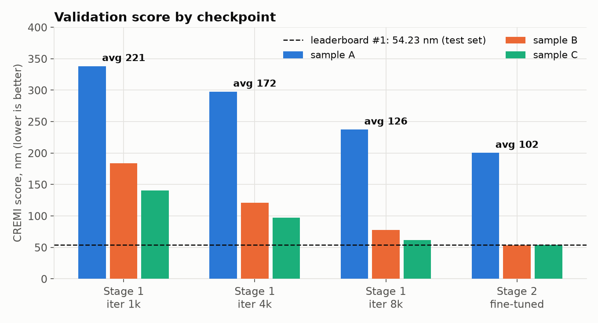
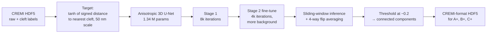
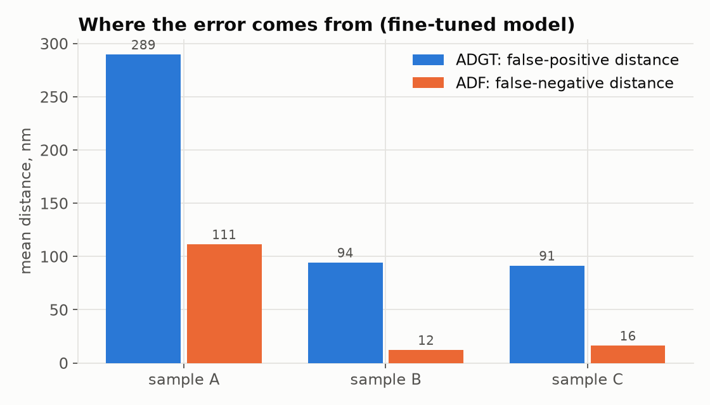
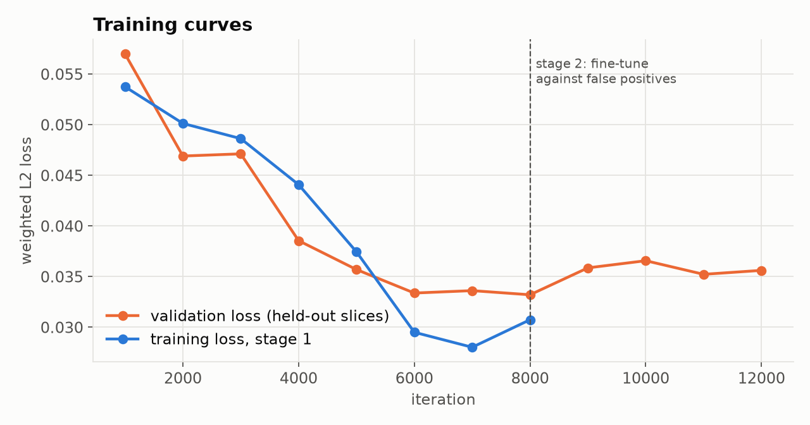
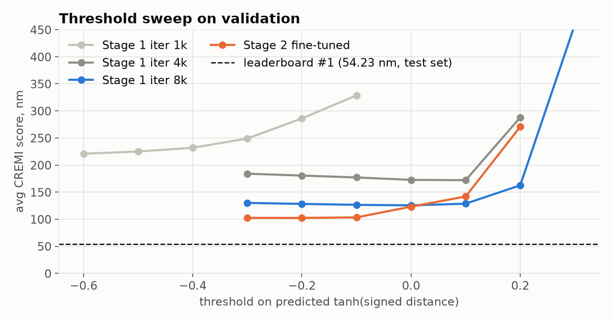
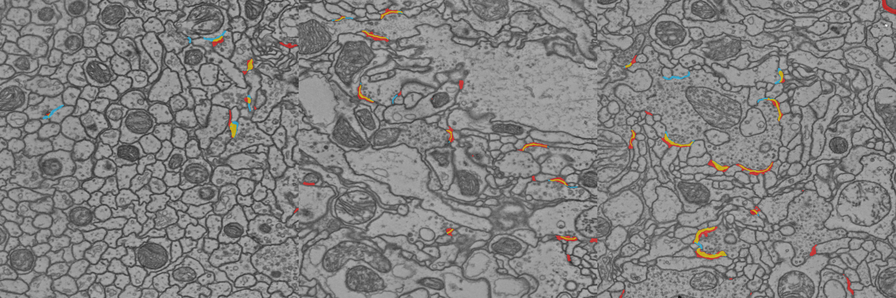
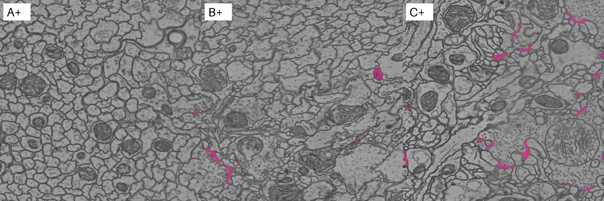

# CREMI synaptic cleft detection

An attempt at the [CREMI challenge](https://cremi.org) "Synaptic clefts" category. The task is to segment synaptic
clefts in serial-section TEM volumes of adult *Drosophila* brain. Each volume is 125 × 1250 × 1250 voxels at
40 × 4 × 4 nm.

**Result:** CREMI score **102.4 nm** averaged over held-out validation slices of samples A, B and C (lower is better).
On B and C the score is 53 nm. The leaderboard's #1 entry scores 54.2 nm on the hidden test set. Sample A is much
worse (200 nm) because of false positives. Prediction files for the test volumes A+, B+ and C+ are in `submission/`.
They have not been uploaded to the leaderboard.



## Method



- **Target.** The network regresses a tanh-scaled signed distance to the nearest cleft voxel, `tanh(d / 50 nm)`,
  which is positive inside clefts. This follows Heinrich et al. 2018, *Synaptic cleft segmentation in non-isotropic
  volume electron microscopy of the complete Drosophila brain* (MICCAI).
- **Network.** 3D U-Net with 16, 32, 64 and 128 channels and GroupNorm. The data is anisotropic, so the first two
  poolings are xy-only (1,2,2) and the last is (2,2,2). The first level uses xy-only kernels.
- **Apple-silicon speed-up.** `Conv3d` is slow on the MPS backend. Every convolution is written as a `Conv2d` over
  (B·Z, C, H, W), and a 3×3×3 convolution is computed exactly by stacking slices z−1, z and z+1 along the channel
  axis. This roughly halved the time per iteration (1.55 s to 0.76 s on an M5).
- **Training.** 16 × 192 × 192 patches, batch size 2, AdamW, cosine learning-rate schedule, weighted L2 loss with
  cleft voxels upweighted. Augmentation: flips, xy transpose, per-section contrast and brightness, gamma, simulated
  missing sections, and Gaussian noise.
  - Stage 1: 8000 iterations, learning rate 1e-3, half of patches centred on a cleft, positive weight capped at 5.
  - Stage 2: 4000 iterations, learning rate 3e-4, 30% of patches centred on a cleft, positive weight capped at 2.
    This stage pushes the model away from false positives.
- **Inference.** 16 × 256 × 256 tiles with overlap cropping, averaged over 4 flips, then thresholded. The threshold,
  minimum component size and hysteresis seed were grid-searched on validation. A plain threshold of −0.2 worked best.
- **Split.** The model trained on slices 0–99 of each training volume. Slices 100–124 were held out for validation.
- **Metric.** The official CREMI cleft metric, ported from `cremi_python` (`src/cremi_metric.py`):
  CREMI = (ADGT + ADF) / 2.
  - ADGT is the mean distance from predicted cleft voxels to the nearest ground-truth cleft (penalises false positives).
  - ADF is the mean distance from ground-truth cleft voxels to the nearest prediction (penalises misses).

## Results

### Validation (held-out slices 100–124)

| Model | Threshold | A | B | C | **Average** |
|---|---|---|---|---|---|
| Stage 1, iteration 1000 | −0.6 | 338.3 | 184.0 | 140.6 | 221.0 |
| Stage 1, iteration 4000 | +0.1 | 297.7 | 121.0 | 97.5 | 172.1 |
| Stage 1, iteration 8000 | 0.0 | 237.4 | 77.7 | 61.6 | 125.6 |
| **Stage 2 (fine-tuned)** | −0.2 | 200.4 | **53.1** | **53.7** | **102.4** |

All values are CREMI scores in nm. Full per-sample ADGT and ADF values are in
[`results/validation_scores.csv`](results/validation_scores.csv). Every threshold, size and seed combination that was
tried is in [`results/threshold_sweep.csv`](results/threshold_sweep.csv).

For context, the [CREMI leaderboard](https://cremi.org/leaderboard/) has 102 cleft entries. #1 scores 54.23 nm, and
the top 25 range from 54 to 65 nm. Those are hidden-test scores. The numbers above come from held-out slices of the
training volumes, which are probably easier, so they are not directly comparable.



Most of the remaining error is false positives (ADGT), especially in sample A. A's left side is a bundle of
small-calibre axons with very few annotated synapses, and the model marks dense-core vesicles and mitochondrial
edges there as clefts.



Validation loss goes slightly *up* in stage 2 while the CREMI score improves from 126 to 102. The loss upweights cleft
voxels, so it rewards over-prediction. The CREMI metric penalises the scattered false positives that stage 2 removed.



### Qualitative

The panels below show validation slice 112 for samples A, B and C. Yellow is a correct prediction, red is a false
positive, and blue is a missed cleft. Most red pixels are predicted clefts drawn a little thicker than the thin
ground-truth label.



The next panels show test-set predictions (slice 62 of A+, B+ and C+), with predicted clefts in magenta.



### Test-set predictions

`submission/sample_{A+,B+,C+}_clefts_prediction.hdf` each contain `volumes/labels/clefts`: uint64, background
`0xffffffffffffffff`, one id per connected component, attribute `resolution = [40, 4, 4]`.

| Test volume | Predicted clefts | Cleft voxel fraction | Training counterpart |
|---|---|---|---|
| A+ | 231 | 0.13% | A: 0.23% |
| B+ | 446 | 0.40% | B: 0.24% |
| C+ | 732 | 1.47% | C: 0.72% |

C+ gets about twice the cleft fraction of C, spread evenly across slices rather than caused by defective slices.
Either C+ has denser synapses or the model over-predicts there. This can't be checked without the hidden labels.

## Repository layout

```
src/
  cremi_metric.py   CREMI cleft metric (ADGT, ADF, CREMI score)
  common.py         data loading, U-Net, sliding-window inference, post-processing
  train.py          training; --init / --pos-frac / --wpos-max for fine-tuning
  evaluate.py       validation grid search and submission writer
  make_figures.py   figures and CSV tables
runs/               checkpoints (*.pt), training logs, validation grids (val_results.json)
results/            CSV tables
figs/               figures
submission/         CREMI-format test predictions
download_data.sh    fetches the six cropped CREMI volumes (~1 GB) into data/
```

The data, cached targets and raw prediction arrays (`*.npy`) are about 4 GB in total and are not in git.
`download_data.sh` fetches the data again.

## Reproduce

Requirements: Python 3, PyTorch (MPS or CUDA), h5py, numpy, scipy, matplotlib and Pillow.

```bash
./download_data.sh
cd src
python3 train.py --iters 8000                                    # stage 1, ~2 h on an M5 MacBook
cp ../runs/unet/model.pt ../runs/unet/model_it8000.pt
python3 train.py --init ../runs/unet/model_it8000.pt --iters 4000 --lr 3e-4 --warmup 100 \
                 --pos-frac 0.3 --wpos-max 2 --out ../runs/ft      # stage 2, ~1.2 h
python3 evaluate.py --model ../runs/ft/model.pt                  # validation and threshold search
python3 evaluate.py --model ../runs/ft/model.pt --thresh -0.2 --submit   # test predictions
python3 make_figures.py
```

## What would likely help next

- **Train much longer.** Top entries trained for hundreds of thousands of iterations; this run did 12k.
- **Use a bigger model and more xy context.** Many false positives need a wider field of view to rule out.
- **Use the padded CREMI volumes** for more context at the borders, and add elastic and misalignment augmentation.
- **Retrain on all 125 slices** for the final test model. The model here was trained on the validation split.

## Data and references

- CREMI data and metrics: https://cremi.org/data/, https://cremi.org/metrics/
- Heinrich L., Funke J., Pape C., Nunez-Iglesias J., Saalfeld S. (2018). *Synaptic cleft segmentation in
  non-isotropic volume electron microscopy of the complete Drosophila brain.* MICCAI 2018. arXiv:1805.02718
